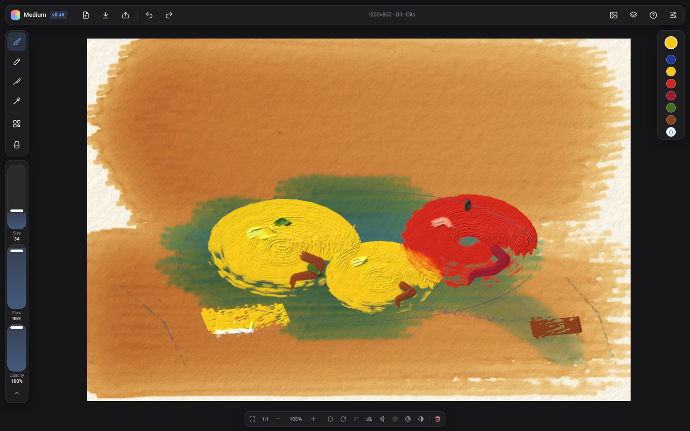
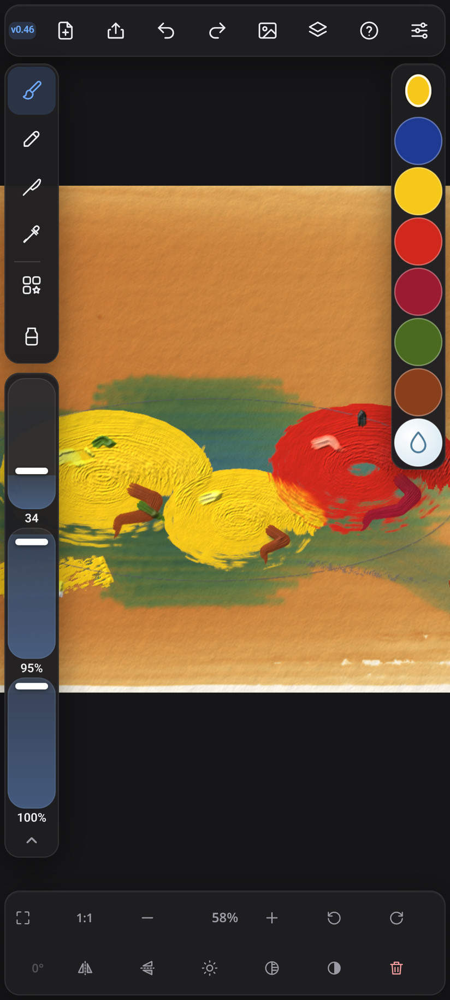
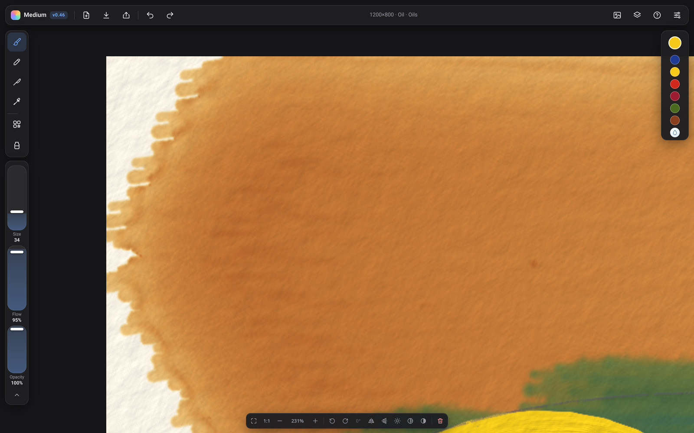
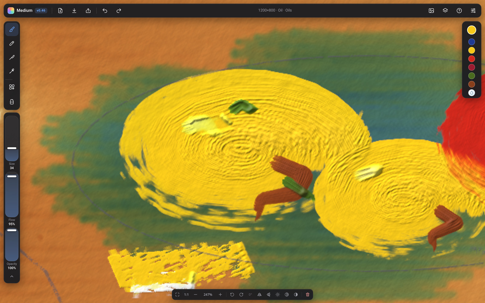
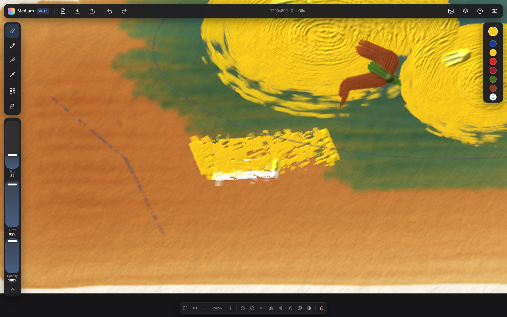
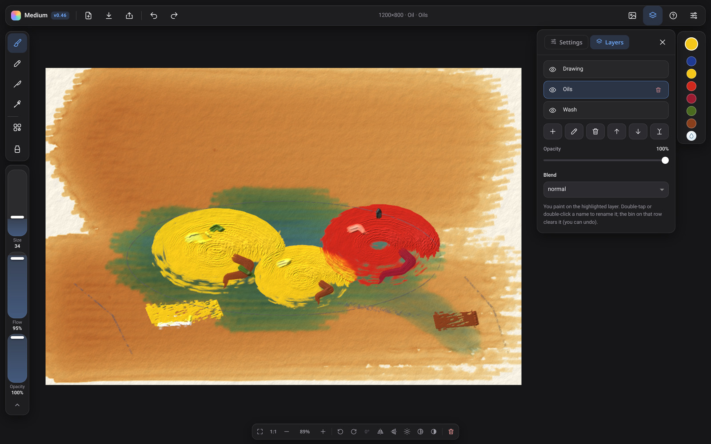

# Medium — realistic paint simulator

Paint in the browser with watercolour, gouache, acrylic, oil, ink and pencil. Bristles, a palette knife, and the way pigment mixes and dries are all simulated, not just stamped on.

**[Open the live app](https://wzwow.github.io/paint-sim/)** — no account, nothing to install (unless you want to).

  

## Features

- **Media:** watercolour, gouache, acrylic, oil, ink, and graphite or coloured pencil
- **Bristle brushes** with presets (washes, dry brush, filbert, fan blender, liners and more), plus a **palette knife** that can lay or scrape thick paint
- **Clear water / clear medium** (the water-drop, or W): re-wet and lift dried watercolour or ink; thin and blend wet oil or acrylic, with no colour added
- **Pen pressure and tilt**, including the Samsung S Pen — press harder, tilt to shade
- **Layers** in their own tab, with opacity, blend modes, rename, merge and a clear-layer button
- **Canvas surfaces:** cold-press, hot-press and rough paper, linen or cotton canvas, and a smooth panel
- **Lighting and relief**, so thick oil catches the light; plus a greyscale value check and a flat view that hides lighting
- **Colour tools:** pigments, a wheel or square picker, HSB/RGB numbers, warmer/cooler/lighter/darker (mixed as paint), pins, recent colours, and an eyedropper
- **View controls:** fit, 100%, zoom, rotate, and a left–right or upside-down **flip** to check the drawing (the painting itself is not flipped)
- **Share a PNG** with an editable copy of the project inside — open it again in Medium and keep painting
- **Save and open** `.mpaint` project files; export PNG, JPEG or WebP, with or without the paper, at 1× or 2×
- **Install as an app** (PWA) and keep working **offline**; work is **autosaved** on your device
- A reference image can sit beside the canvas, or be traced over it, without being painted or exported

## How to use

On a computer, use a mouse or a pressure-sensitive pen. Pick a medium and a brush preset, choose a colour, and paint. Size, Flow and Opacity sit under the tools on the left; colours are on the right; canvas controls (fit, zoom, rotate, flip, lighting, clear layer) run along the bottom.

On a phone or tablet the layout is the same, so nothing is hidden in a different place. A keyboard is optional. The S Pen side button can open a quick colour ring (this has not been widely tested on a real device yet).

Open **Layers** from the stacked-squares button, or press L. Open **Settings** from the sliders button. Help and every shortcut is under **?** or F1.

## Keyboard shortcuts

On a Mac, use ⌘ wherever this table says Ctrl. `[` and `]` are the square-bracket keys.

| Shortcut | What it does |
| --- | --- |
| B | Brush |
| P | Brush presets |
| K | Palette knife |
| G | Pencil (graphite or coloured) |
| W | Clear water / clear medium on or off |
| Ctrl+Z | Undo |
| Ctrl+Shift+Z or Ctrl+Y | Redo |
| Ctrl+Shift+E | Export image… |
| Ctrl+Shift+S | Share painting… (a picture with an editable copy inside) |
| Ctrl+S | Save project file (`.mpaint`) |
| Ctrl+O | Open project file |
| ? or F1 | Open or close help |
| L | Open or close the Layers tab |
| F2 | Rename the current layer |
| ↑ / ↓ | Select the layer above or below, when the layer list has focus |
| Hold Space and drag, or middle-button drag | Move the canvas |
| Mouse wheel | Zoom in or out at the pointer |
| Ctrl++ / Ctrl+− | Zoom in or out at the centre |
| Ctrl+0 | Fit the canvas to the screen and straighten it |
| Ctrl+1 | Zoom to 100% |
| H | Mirror the view left–right (the painting is not changed) |
| Shift+H | Flip the view upside down (the painting is not changed) |
| R / Shift+R | Rotate the view 15° right or left |
| Hold Shift and paint | Keep painting with what is left on the brush (dry-brush) |
| I, or hold Alt and click | Pick a colour from the painting |
| T | Show or hide the reference image traced over the canvas |
| Shift+T | Move, resize or turn the trace |
| [ / ] | Brush, knife or pencil size smaller / bigger (Shift for bigger steps) |
| Shift+Delete or Shift+Backspace | Clear the current layer (asks first; you can undo it) |
| Esc | Close the colour picker, the Medium menu, help or a dialog |

The view bar also has **Shift+L** for light and relief, **Shift+V** for a greyscale value check, and **Shift+F** for a flat view with lighting hidden.

## Browser

Medium needs a recent browser with **WebGL2** — Chrome, Edge, Firefox or Safari are all fine. You can install it from the browser as a standalone app and use it offline.

How it looks and how smoothly it runs depends on your device and browser. There is no account to create.

## Privacy

The app runs entirely in your browser. Paintings are not uploaded anywhere. Autosave, project files and exported pictures stay on your device. Sharing writes a file that you choose to send or save.

## How it works

Medium is a GPU paint simulation in WebGL2. Pigments are mixed in a Kubelka-Munk-style model, the way real paint absorbs and scatters light, rather than only blending screen colours.

In watercolour and ink, water spreads and evaporates, and pigment settles as a wash dries, so the edge can darken. Oil can sit in ridges that catch a movable light. It is a simulation in the browser, not a photograph of real paint, and the result varies from device to device.

## About this project

Medium is an ongoing personal project, published as a public demo at [wzwow.github.io/paint-sim](https://wzwow.github.io/paint-sim/).
